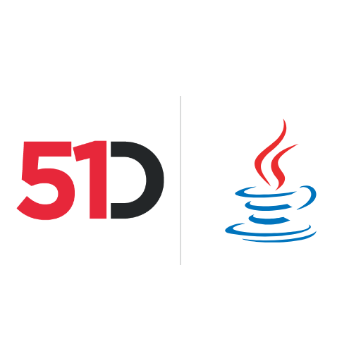

# 51Degrees Device Detection and IP Intelligence for Java



**Java packages for the Pipeline API, Device Detection, IP Intelligence and Location**

Our User-Agent parser for Java supports Device Detection, browser detection, mobile detection, and crawler detection on-premise or in the cloud. IP Intelligence adds IP geolocation, including IP to country data.

It reads User-Agent and User-Agent Client Hints, HTTP request headers that carry browser and device information. For cloud bot detection, Human Confidence reports confidence that a person is viewing the page.

## Install

Each product is a separate Maven Central package. For Device Detection, cloud or on-premise:

```xml
<!-- Make sure to select the latest version from https://mvnrepository.com/artifact/com.51degrees/pipeline.device-detection -->
<dependency>
    <groupId>com.51degrees</groupId>
    <artifactId>device-detection</artifactId>
    <version>4.5.x</version>
</dependency>
```

The product guides below list the other packages. To build from source, see [Getting the code](#getting-the-code).

Try the [User-Agent tester](https://51degrees.com/developers/user-agent-tester?utm_source=github&utm_medium=readme&utm_campaign=51degrees-java&utm_content=readme.md&utm_term=install) and [IP tester](https://51degrees.com/developers/ip-tester?utm_source=github&utm_medium=readme&utm_campaign=51degrees-java&utm_content=readme.md&utm_term=install). For cloud use, [create a Resource Key](https://51degrees.com/configure/?utm_source=github&utm_medium=readme&utm_campaign=51degrees-java&utm_content=readme.md&utm_term=install).

Created from `pipeline-java`, `device-detection-java`, `ip-intelligence-java`, `location-java`, `device-detection-java-examples`, and `ip-intelligence-java-examples`, this repository continues their work.

| Product | Read first | Documentation |
| --- | --- | --- |
| Pipeline API | [pipeline/README.md](pipeline/README.md) | [Guide](https://51degrees.com/documentation/_pipeline_api__concepts__pipeline_basics.html?utm_source=github&utm_medium=readme&utm_campaign=51degrees-java&utm_content=readme.md&utm_term=pipeline-guide) and [Java API](https://51degrees.com/documentation/apis/pipeline-java/annotated.html?utm_source=github&utm_medium=readme&utm_campaign=51degrees-java&utm_content=readme.md&utm_term=pipeline-java) |
| Device Detection | [device-detection/README.md](device-detection/README.md) | [Guide](https://51degrees.com/documentation/_device_detection__quickstart.html?utm_source=github&utm_medium=readme&utm_campaign=51degrees-java&utm_content=readme.md&utm_term=device-detection-guide) and [Java API](https://51degrees.com/documentation/apis/device-detection-java/annotated.html?utm_source=github&utm_medium=readme&utm_campaign=51degrees-java&utm_content=readme.md&utm_term=device-detection-java) |
| IP Intelligence | [ip-intelligence/README.md](ip-intelligence/README.md) | [Guide](https://51degrees.com/documentation/_ip_intelligence__quickstart.html?utm_source=github&utm_medium=readme&utm_campaign=51degrees-java&utm_content=readme.md&utm_term=ip-intelligence-guide) and [Java API](https://51degrees.com/documentation/apis/ip-intelligence-java/annotated.html?utm_source=github&utm_medium=readme&utm_campaign=51degrees-java&utm_content=readme.md&utm_term=ip-intelligence-java) |
| Location | [location/README.md](location/README.md) | [Guide](https://51degrees.com/documentation/_reverse_geocoding__quickstart.html?utm_source=github&utm_medium=readme&utm_campaign=51degrees-java&utm_content=readme.md&utm_term=location-guide) and [Java API](https://51degrees.com/documentation/apis/location-java/annotated.html?utm_source=github&utm_medium=readme&utm_campaign=51degrees-java&utm_content=readme.md&utm_term=location-java) |

## What is where

| Path | Contents |
| --- | --- |
| `pipeline` | The Pipeline API packages, `com.51degrees:pipeline.*` |
| `device-detection` | The Device Detection packages, `com.51degrees:device-detection*` |
| `ip-intelligence` | The IP Intelligence packages, `com.51degrees:ip-intelligence*` |
| `location` | The Location packages, `com.51degrees:geo-location*` |
| `examples/device-detection` | Console and web examples for Device Detection |
| `examples/ip-intelligence` | Console and web examples for IP Intelligence, including the mixed examples that run both products |
| `cxx` | Submodule of [51degrees-cxx](https://github.com/51Degrees/51degrees-cxx), with the C and C++ code the on-premise engines are built from and the [data](https://github.com/51Degrees/data) submodule in `cxx/data` |
| `pom.xml` | The reactor that builds everything here. It is never published |
| `ci` | The scripts the shared 51Degrees CI workflows call |

## Getting the code

```
git clone --recurse-submodules https://github.com/51Degrees/51degrees-java.git
cd 51degrees-java
```

The free data files come from the [data](https://github.com/51Degrees/data)
repository, which is the `cxx/data` submodule. Each one is listed there as a
`.link` file, and a script downloads them all into place:

```
cxx/data/get-data-files.sh
```

On Windows, run `cxx\data\get-data-files.ps1` in PowerShell instead. The
examples run the script themselves for a free file they need that is missing.

In a clone made before the data repository was added, delete the
`cxx/device-detection-data` and `cxx/ip-intelligence-data` folders once cxx no
longer includes them, because Git leaves a removed submodule's folder on disk.

## Building

You need a JDK (8 or later) and either Maven 3.8 or later or the `mvnw`
wrapper in this folder. The two on-premise engines compile their native
library during the build, which needs CMake 3.10 or later and a C++ toolchain:
Visual Studio with the C++ workload on Windows, GCC or Clang elsewhere.

From this folder:

```
mvn install -DskipTests
```

That builds every package in dependency order, so a change to `pipeline` is
seen by `device-detection` in the same build. To skip the native libraries,
for example on a machine without a C++ toolchain, add `-DskipNativeBuild=true`.
To build one product and what it depends on, name its folder:

```
mvn install -DskipTests -pl device-detection -am
```

## Tests

```
mvn surefire:test
```

The cloud tests need a Resource Key, passed as `-DTestResourceKey=<key>`. The
on-premise tests need the free data files, which the script in
[Getting the code](#getting-the-code) downloads. For the Enterprise IP
Intelligence data file, see `ip-intelligence/README.md`.

Every environment variable name that the packages, tests, examples and CI
scripts read is in [common-ci's list of environment variable names](https://github.com/51Degrees/common-ci/blob/d8a9c596eabf69dd5581a08e9360cdd1c9b3d9e8/environment-variables.md),
which decides.
Tests find data files by searching from the root of this repository, so run
Maven from here rather than from inside a package folder.

## Examples

The examples reference the packages published to Maven Central, which is how
a project of your own uses them. To build and run them against the libraries
in this repository instead, activate the `dev` profile:

```
mvn install -DskipTests -Pdev
```

## Regenerating the SWIG wrappers

The C++ wrappers `Java_Hash_Engine.cpp` and `Java_Ipi_Engine.cpp` are
generated and must not be edited by hand. They include the C++ headers through
`cxx/`, so SWIG needs the root of this repository on its include path. With
SWIG 4.0 or later, from this folder:

```
cd device-detection/device-detection.hash.engine.on-premise/src/main/cxx
swig -c++ -java -I../../../../.. -package fiftyone.devicedetection.hash.engine.onpremise.interop.swig -outdir ../java/fiftyone/devicedetection/hash/engine/onpremise/interop/swig -o Java_Hash_Engine.cpp hash_java.i
```

The IP Intelligence engine has `RegenSwig.ps1` beside its interface file that
does the same.

## Versions

Each package has its own version, and a release publishes only the packages
that changed since their last release and the packages that depend on them.
A change only to documentation, tests, examples or the descriptive parts of a
`pom.xml`, such as its links, releases nothing.
Each is tagged with its name and version, such as `pipeline.core/4.5.131`.
[ci/README.md](ci/README.md) describes how CI works out what to release.

## History

| Earlier repository | What it held |
| --- | --- |
| [pipeline-java](https://github.com/51Degrees/pipeline-java) | The Pipeline API |
| [device-detection-java](https://github.com/51Degrees/device-detection-java) | Device Detection |
| [ip-intelligence-java](https://github.com/51Degrees/ip-intelligence-java) | IP Intelligence |
| [location-java](https://github.com/51Degrees/location-java) | Location |
| [device-detection-java-examples](https://github.com/51Degrees/device-detection-java-examples) | Device Detection examples |
| [ip-intelligence-java-examples](https://github.com/51Degrees/ip-intelligence-java-examples) | IP Intelligence examples |


The folders `pipeline`, `device-detection`, `ip-intelligence`, `location` and
the two example folders were brought in from the separate repositories
[pipeline-java](https://github.com/51Degrees/pipeline-java),
[device-detection-java](https://github.com/51Degrees/device-detection-java),
[ip-intelligence-java](https://github.com/51Degrees/ip-intelligence-java),
[location-java](https://github.com/51Degrees/location-java),
[device-detection-java-examples](https://github.com/51Degrees/device-detection-java-examples)
and
[ip-intelligence-java-examples](https://github.com/51Degrees/ip-intelligence-java-examples)
with `git subtree add`, without `--squash`, so every commit keeps its original
SHA. The history of a file before the import is under its old path, so read it
from the imported commit, for example `git log aff7c544 -- pom.xml` for what is
now `pipeline/pom.xml`.

## License

[European Union Public Licence v1.2](LICENSE)

## Find out more

- [Device Detection](https://51degrees.com/device-detection?utm_source=github&utm_medium=readme&utm_campaign=51degrees-java&utm_content=readme.md&utm_term=find-out-more)
- [IP Intelligence](https://51degrees.com/ip-intelligence?utm_source=github&utm_medium=readme&utm_campaign=51degrees-java&utm_content=readme.md&utm_term=find-out-more)
- [Bots and humans](https://51degrees.com/bots-and-humans?utm_source=github&utm_medium=readme&utm_campaign=51degrees-java&utm_content=readme.md&utm_term=find-out-more)
- [Documentation](https://51degrees.com/documentation/index.html?utm_source=github&utm_medium=readme&utm_campaign=51degrees-java&utm_content=readme.md&utm_term=find-out-more)
- https://github.com/51Degrees/51degrees-cxx
